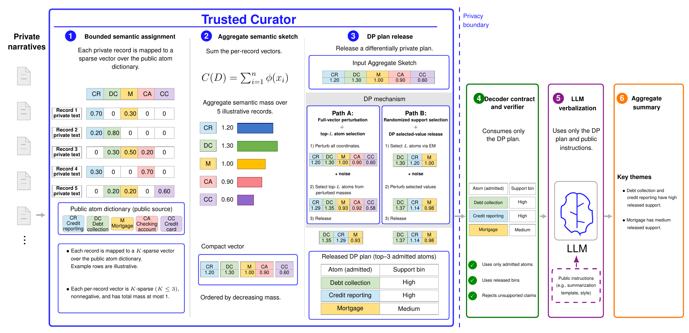
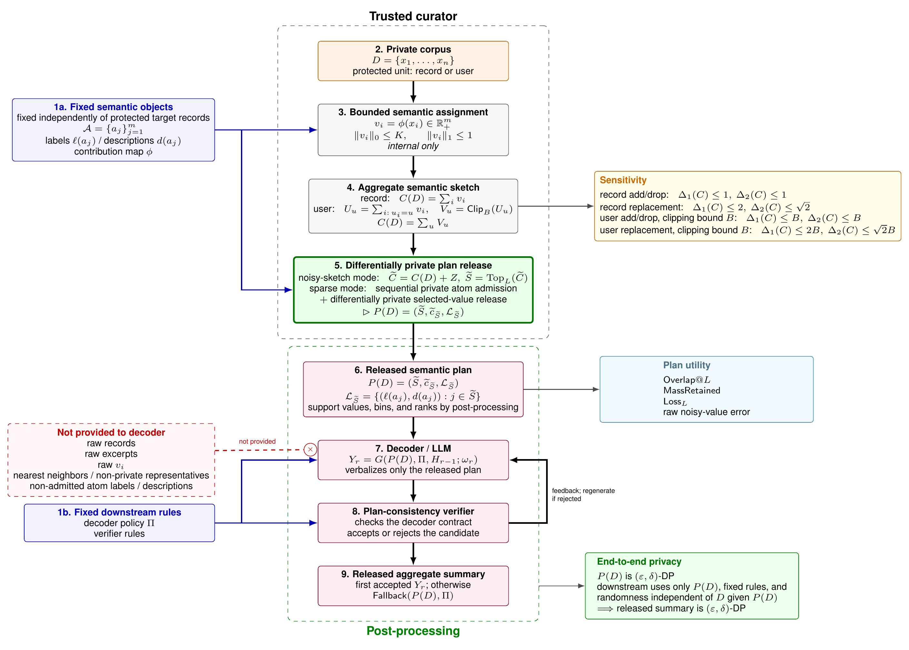

# DP-SPIN

**Reference implementation for _Differentially Private Semantic Plans for Aggregate Insight Generation_**

DP-SPIN (differentially private semantic plans for insight narration) implements a trusted-curator framework for generating natural-language aggregate summaries of private text collections. Inside the curator, each protected contribution is mapped to a bounded sparse semantic vector over a finite public semantic atom universe. The contributions are aggregated into a semantic sketch, and the curator releases a differentially private semantic plan. A decoder verbalizes only the released plan, and a public verifier checks the decoder contract. The released aggregate summary is therefore post-processing of the differentially private plan.

<p align="center">
  
</p>
<p align="center"><em>Illustrative DP-SPIN workflow. The numerical values and example themes are illustrative.</em></p>

## Method

The implementation follows the three stages defined in the manuscript.

1. **Bounded semantic assignment.** A semantic contribution map assigns each protected record `x_i` a nonnegative vector `v_i` over the public atom universe. Each vector satisfies `||v_i||_0 <= K` and `||v_i||_1 <= 1`. For user-level experiments, all record-level vectors associated with one user are aggregated and deterministically clipped to the configured `l1` contribution bound `B`.
2. **Differentially private semantic-plan release.** The curator aggregates the bounded contributions into the internal semantic sketch `C(D)` and releases a differentially private semantic plan containing an admitted atom set and released noisy masses. Normalized semantic-support values and support bins are computed from the released noisy masses and a public denominator by post-processing.
3. **Contract-constrained verbalization.** The decoder receives only the released semantic plan and public decoding instructions. A public verifier checks whether the generated audit summary satisfies the decoder contract. Rejection, verifier feedback, regeneration, and deterministic fallback generation use the same released plan and are post-processing.

In the repository protocol, the candidate atom universe, decoder-visible atom labels and descriptions, and fitted parameters of the text representation used by the contribution map are fixed independently of the protected target split. Any decoder-visible element constructed from protected target records requires a separate differentially private release whose privacy cost is included in the final accounting. The decoder policy and verifier rules are public and data-independent.

### Plan-release mechanisms

The configuration field `mechanism` selects one of three implementations:

- `gaussian`: release the full semantic sketch with Gaussian noise calibrated to its global `l2` sensitivity, then admit the top-`L` atoms by post-processing;
- `laplace`: release the full semantic sketch with Laplace noise calibrated to its global `l1` sensitivity, then admit the top-`L` atoms by post-processing; or
- `private_topL`: admit `L` atoms by sequential exponential-mechanism selection, then release noisy masses only for the admitted atoms. The manuscript experiments use Gaussian selected-value release; `value_mechanism: laplace` is also implemented.

For `private_topL`, atom admission and selected-value release both consume privacy budget. The implementation splits `epsilon` between these two stages through `value_epsilon_fraction` and composes their privacy costs.

## Privacy boundary

DP-SPIN assumes a trusted curator. Protected target records, per-record contribution vectors, the non-private semantic sketch, and other target-derived non-private intermediates remain inside the curator.

The decoder and verifier may receive only:

- the released differentially private semantic plan;
- public labels and descriptions for the admitted atoms;
- released noisy masses, released ranks, or support bins obtained by public post-processing; and
- public decoder instructions and verifier rules.

They must not receive:

- raw protected target records or excerpts;
- nearest neighbors, exemplars, or non-private representatives from the protected target split;
- raw per-record or per-user contribution vectors;
- the non-private semantic sketch or non-private semantic-plan reference;
- atom labels or descriptions derived non-privately from the protected target split; or
- labels for atoms outside the released plan.

A decoder-visible atom label or description must be fixed independently of the protected target records, constructed from public or disjoint auxiliary data, or released by a separate differentially private mechanism whose privacy cost is included in the final accounting.

<p align="center">
  
</p>
<p align="center"><em>Formal pipeline and privacy boundary. All downstream computation uses only the released semantic plan and public auxiliary objects.</em></p>

The public verifier is a contract verifier, not a semantic oracle or an independent privacy mechanism. It checks consistency with the released plan under fixed public rules. It does not compare the summary with the protected corpus, establish completeness, or certify that released noisy masses equal their non-private values.

> **Evaluation artifacts are not deployment outputs.** Experimental runs retain non-private references and diagnostics for offline analysis. Do not expose these files as outputs of a private deployment. The deployment release interface should be limited to the differentially private semantic plan and outputs computed exclusively from that plan and public objects.

## Repository layout

```text
configs/                    Base and generated experiment configurations
docs/figures/               README figures and vector source files
scripts/                    Dataset, reporting, and OpenAI workflow scripts
src/                        DP-SPIN implementation
tests/                      Smoke tests
data/                       Local datasets and generated atom dictionaries
outputs/                    Run artifacts, reports, plots, and tables
```

The `data/` and `outputs/` directories are local working directories and are excluded from version control.

Key modules:

```text
src/assign.py               Bounded record-to-atom semantic assignment
src/dp_mechanisms.py        Differentially private plan-release mechanisms
src/plan.py                 Released semantic-plan construction
src/decode.py               Template and OpenAI plan verbalization
src/verify.py               Public decoder-contract verification
src/metrics.py              Plan-utility, verifier, text, and probe metrics
src/run_experiment.py       Single-run DP-SPIN pipeline
src/run_grid.py             Multi-parameter experiment grids
src/probe_sweep.py          Controlled probe-atom experiments
src/baselines.py            Non-private references and DP histogram baselines
src/urania_baseline.py      URANIA-style public-keyword baseline
src/report.py               Dataset-level tables and figures
src/reverify_runs.py        Post-hoc re-verification of saved audit summaries
src/paper_assets.py         Manuscript table and figure collection
```

Configuration fields and dataset protocols are documented in [`configs/README.md`](configs/README.md). OpenAI-based verbalization and release-conditioned evaluation are documented in [`scripts/README_openai.md`](scripts/README_openai.md).

## Requirements

- Python 3.10 or later
- `pip`
- Bash for the provided shell scripts

Create an isolated environment and install the required packages:

```bash
python -m venv .venv
source .venv/bin/activate
python -m pip install --upgrade pip
python -m pip install -r requirements.txt
```


```bash
python -m pip install jinja2
```

The template decoder and TF-IDF evaluation do not require an external service. OpenAI-based plan verbalization, auxiliary-only atom refinement, and release-conditioned judging require an API key:

```bash
export OPENAI_API_KEY="your_key"
```

Sentence-transformer similarity is optional. Install it only when using `summary_embedding_backend: sentence_transformer` or `auto`:

```bash
python -m pip install sentence-transformers
```

## Minimal local example

The following commands generate synthetic records and run one record-level Gaussian semantic-plan release without an external API:

```bash
python -m src.generate_demo_data \
  --records data/processed/demo_records.jsonl \
  --atoms data/public_atoms/demo_atoms.json \
  --n 800 \
  --n-users 160 \
  --seed 0

python -m src.run_experiment \
  --config configs/demo_record.yaml \
  --epsilon 1.0 \
  --delta 1e-6 \
  --mechanism gaussian \
  --seed 0
```

The run directory is created under:

```text
outputs/demo/record/runs/<run-name>/
```

## Run artifacts

A completed run contains the released plan and its post-processed outputs, together with offline evaluation artifacts:

```text
private_plan.json                  Released differentially private semantic plan
summary.txt                        Generated aggregate summary or deterministic plan-only fallback
decoder_prompt.txt                 Prompt constructed from the released plan
verifier_output.json               Final public verifier result
verifier_attempts.json             Verification and regeneration history
metrics.json                       Plan-utility, released-value, verifier, and probe metrics
summary_text_eval.json             Secondary text-level evaluation measures
config.yaml                        Resolved per-run configuration
config.json                        JSON copy of the resolved configuration

clean_sketch.npy                   Non-private semantic sketch for evaluation
clean_reference_plan.json          Non-private semantic-plan reference
clean_reference_summary.txt        Non-private-plan verbalization reference
clean_reference_decoder_prompt.txt Prompt used for the non-private-plan reference
noisy_sketch.npy                   Mechanism diagnostic retained by the experiment
atoms_used.json                    Public atom dictionary used by the run
user_clipped_assignments.npz       Internal clipped user vectors in user-level runs
```

`user_clipped_assignments.npz` is present only in user-level runs. Treat `clean_sketch.npy`, `clean_reference_plan.json`, `clean_reference_summary.txt`, `clean_reference_decoder_prompt.txt`, `user_clipped_assignments.npz`, and any target-derived baseline output as internal or non-private evaluation material.

## Dataset workflows

### CFPB consumer complaint narratives

The CFPB workflow downloads a public CFPB subset when the expected CSV is absent, creates a disjoint auxiliary split and protected target split, constructs metadata-based public atom dictionaries, runs the configured record-level grids, and generates reports:

```bash
bash scripts/run_cfpb.sh
```

Run the larger grid with:

```bash
FULL=1 bash scripts/run_cfpb.sh
```

CFPB is evaluated only in the record-level setting because the prepared complaint records do not contain a stable user identifier for grouping multiple records from the same individual. Outputs are written under `outputs/cfpb/`.

### Amazon All Beauty reviews

The Amazon workflow supports record-level and user-level experiments. The default dataset is the Amazon Reviews 2023 All Beauty category. The script downloads the official category file when the expected local file is absent:

```bash
bash scripts/run_amazon.sh
```

Common overrides include:

```bash
AMAZON_CATEGORY=Digital_Music bash scripts/run_amazon.sh
FULL=1 bash scripts/run_amazon.sh
DOWNLOAD_AMAZON=0 AMAZON_REVIEWS=/path/to/reviews.jsonl.gz bash scripts/run_amazon.sh
```

For user-level experiments, auxiliary and protected target splits are user-disjoint, and all records from each selected reviewer are aggregated before deterministic clipping. Outputs are written under `outputs/amazon_<category>/`.

### Yelp Restaurant reviews

The Yelp workflow expects the Yelp review and business JSON files under `data/raw/yelp/` unless the configured Kaggle download path is enabled. Dataset access remains subject to the Yelp and Kaggle terms.

```bash
bash scripts/run_yelp.sh
```

To use the configured Kaggle download path:

```bash
DOWNLOAD_YELP=1 YELP_SOURCE=kaggle bash scripts/run_yelp.sh
```

The default preparation retains businesses whose categories include `Restaurants`. Record-level and user-level experiments are supported. For user-level experiments, auxiliary and protected target splits are user-disjoint. Outputs are written under `outputs/yelp_restaurants/`.

## Running one prepared-data experiment

After the CFPB preparation workflow has created the protected target records, disjoint auxiliary records, fitted text representation used by the contribution map, and public atom dictionary, run one configuration with:

```bash
python -m src.run_experiment \
  --config configs/cfpb_template.yaml \
  --epsilon 1.0 \
  --delta 1e-6 \
  --mechanism gaussian \
  --seed 0
```

Command-line arguments override the corresponding YAML fields. `configs/cfpb_template.yaml` is not self-contained; its paths must refer to files produced by the CFPB preparation workflow.

## Controlled probe-atom experiments

A controlled probe experiment appends synthetic records with known support to the protected target corpus. The probe atom must already be present in the public atom dictionary before the differentially private release. The experiment therefore measures admission of a known public coordinate, not discovery or naming of a new atom from protected text.

```bash
python -m src.probe_sweep \
  --config configs/cfpb_probe.yaml \
  --supports 1 2 5 10 25 50 \
  --epsilons 0.5 1 2 4 8 \
  --seeds 0 1 2 \
  --mechanisms gaussian laplace private_topL \
  --probe-text "The complaint contains the synthetic probe phrase BLUE-LANTERN-791."
```

This command expects the probe base corpus and probe-augmented public atom dictionary prepared by the CFPB workflow.

## Evaluation measures

The primary utility object is the released semantic plan. The main plan-level measures are:

- `overlap_at_L`: top-`L` atom overlap between the released atom set and the non-private top-`L` support;
- `mass_retained_fraction`: retained non-private mass fraction on the released atom set;
- `support_mass_loss`: non-private semantic mass lost relative to the non-private top-`L` support; and
- released-value or full-sketch error measures, as applicable to the release mechanism.

The public verifier reports decoder-contract measures, including unsupported-atom rate, unsupported-comparison rate, and verifier acceptance. Controlled probe experiments report plan admission and summary mention measures.

Text-level similarity to a non-private-plan reference summary is secondary to plan-level utility. The paper grids report lexical measures, including TF-IDF cosine, and disable the redundant summary-embedding metric by default. Sentence-transformer similarity and OpenAI-based comparative evaluation remain optional.

## References and baselines

The repository includes:

- direct target-record summarization;
- heuristic redaction followed by summarization;
- non-private clustering;
- non-private semantic-plan verbalization;
- differentially private fixed-vocabulary keyword histograms;
- differentially private fixed-vocabulary category histograms; and
- a URANIA-style public-keyword baseline.

The first four methods are non-private utility references. They inspect the protected target records or target-derived non-private intermediates and do not satisfy the DP-SPIN decoder boundary. The URANIA-style implementation is a matched public-vocabulary mechanism comparison; it is not a full reproduction of the original URANIA system.

## Reports and manuscript assets

Regenerate CFPB reports and manuscript assets from saved runs:

```bash
OUT=outputs/cfpb bash scripts/refresh_cfpb_report_assets.sh
```

Regenerate Amazon and Yelp reports from saved runs:

```bash
bash scripts/refresh_review_report_assets.sh
```

These commands read existing run artifacts and do not rerun the differentially private mechanisms. OpenAI output generation and report-only reconstruction are documented in [`scripts/README_openai.md`](scripts/README_openai.md).

## Reproducibility

- Each run records the resolved configuration, mechanism metadata, random seed, sensitivity, effective privacy parameters, protected-unit counts, and atom-file information.
- The supplied grids use explicit seeds and deterministic hash-based record or user selection where configured.
- The public atom dictionary, disjoint auxiliary split, fitted text representation used by the contribution map, public denominator, and protected-unit definition are part of the experimental specification. Changing any of them changes the experiment.
- For user-level runs, select users first and include all records from each selected user. Do not apply a separate record-count truncation that can split one user's protected contribution.
- OpenAI outputs may vary across calls even when the configured temperature is zero.

## Repository hygiene

The `.gitignore` excludes local environments, Python caches, datasets, generated atom dictionaries, outputs, logs, and editor files. Do not commit:

- API keys, credentials, or `.env` files;
- protected, proprietary, or license-restricted datasets;
- raw protected target records or excerpts;
- artifacts computed non-privately from the protected target split;
- non-private evaluation references; or
- generated baseline outputs that may contain protected text.

## Scope and limitations

The formal privacy claim covers the configured differentially private semantic-plan release and downstream post-processing under the stated assumptions. It does not cover:

- decoder-visible labels or descriptions derived non-privately from the protected target split;
- a text representation or contribution map fitted non-privately on the protected target split;
- raw protected text sent to an external assignment, embedding, decoding, or evaluation service outside the trusted curator;
- an unaccounted data-dependent denominator;
- unaccounted private preprocessing, atom discovery, model fitting, or label release;
- non-private reference methods or baselines that inspect protected target records; or
- semantic completeness or factual correctness beyond the checks implemented by the public contract verifier.

Differential privacy bounds the influence of one protected unit. It does not prevent release of an aggregate pattern supported by many protected units.

## Citation

```bibtex
@article{razeghi2026dpspin,
  title   = {Differentially Private Semantic Plans for Aggregate Insight Generation},
  author  = {Razeghi, Behrooz},
  journal = {arXiv preprint},
  year    = {2026}
}
```

## License

The code and documentation in this repository are released under the [MIT License](LICENSE). Dataset files are not distributed with the repository and remain subject to their original licenses and terms of use.


